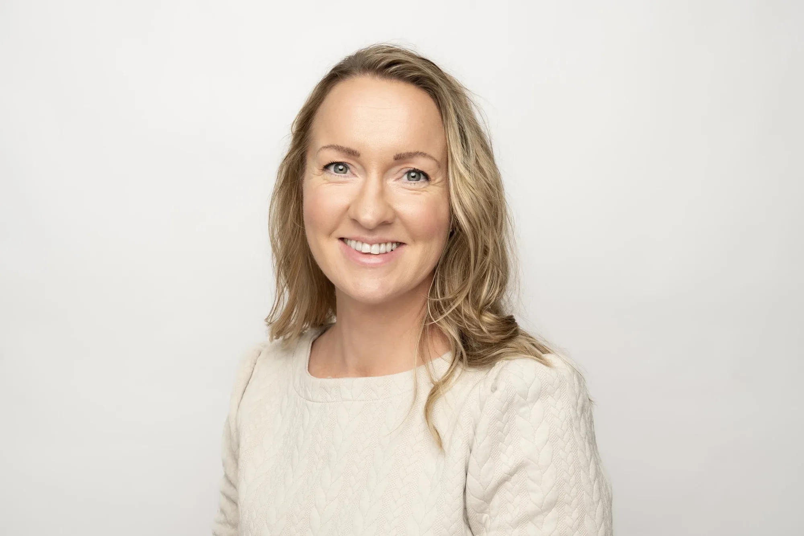

# Ester Svindland

Jeg heter Ester, og er grunnleggeren av Sculpt.

Ideen til Sculpt oppstod da jeg selv var gravid og oppdaget 3D skulpturer i Danmark. Jeg fikk laget en skulptur før fødselen, og det ble et helt spesielt minne fra en tid i livet som går så fort.

Denne opplevelsen inspirerte meg til å starte Sculpt. Jeg ønsket å gi flere gravide i Norge muligheten til å bevare denne tiden på en vakker og personlig måte, som et kunstverk de kan ha med seg resten av livet.

Nå lager jeg også skulpturer av par, barn, familier, idrettsutøvere o.l. og jeg vil fortsette å utvikle Sculpt med nye typer skulpturer.

[Bestill din skulptur]({{contactPage}})

