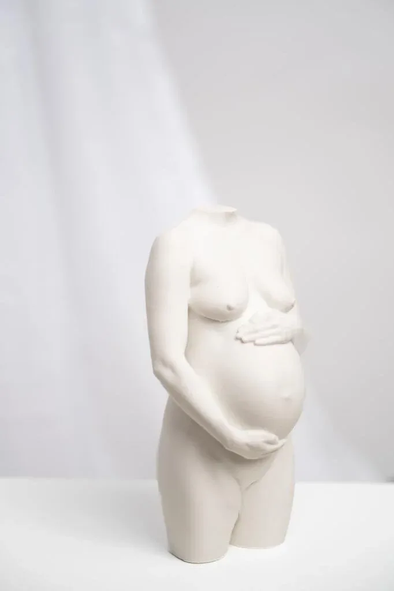

# Sculpt i utvikling

Sculpt er et kunstforetak i kontinuerlig utvikling, med fokus på å forbedre og videreutvikle både produkter og opplevelse. Vi arbeider løpende med nye satsingsområder for å utvide uttrykket og mulighetene innen personlig skulpturkunst.

I tillegg til å etablere flere lokasjoner for å gjøre personlige skulpturer tilgjengelig for flere, utforsker vi også nye elementer for å stadig gjøre produktet bedre, som spesialdesignede sokler og muligheten for metallisering av skulpturene. Dette er løsninger som kan løfte uttrykket ytterligere og gi hvert kunstverk en enda mer eksklusiv og helhetlig fremtoning.

Det er viktig for oss å samarbeide med leverandører og partnere som forstår kvaliteten og det kunstneriske uttrykket i Sculpt, slik at alle tilleggselementer holder samme standard som selve skulpturene.

Dessuten kan vi også tilby bedrifter, kunstnere og idrett samarbeid innenfor vår kategori.

- Nyskapende kunst
- ✳︎
- Kreativ utvikling
- ✳︎
- Tidløs form
- ✳︎
- Unike uttrykk
- ✳︎
- Håndlaget presisjon
- ✳︎
- Personlig kunst
- ✳︎
- Innovativt håndverk
- ✳︎
- Autentisk uttrykk
- ✳︎

