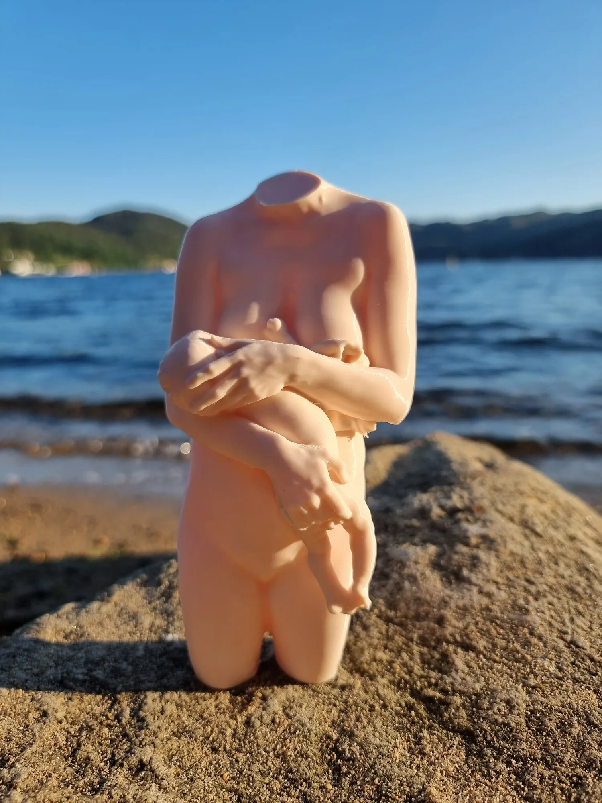
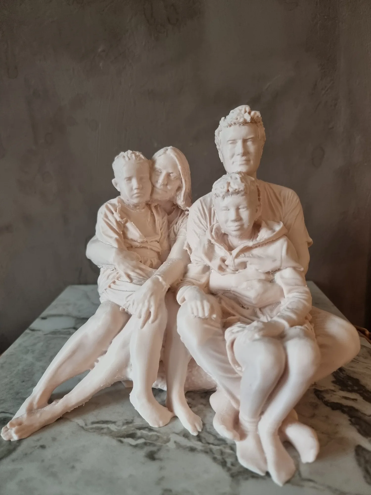
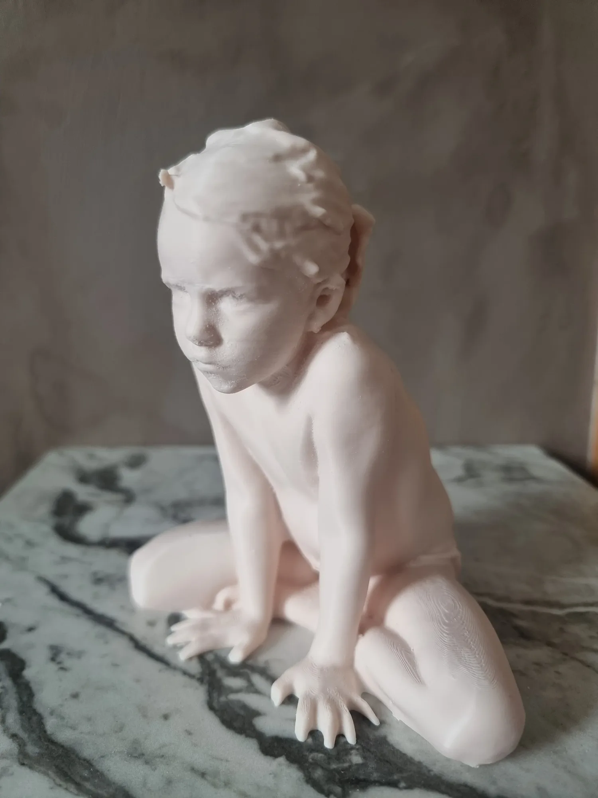
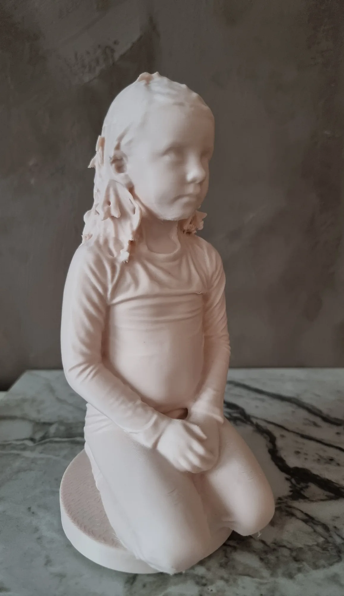
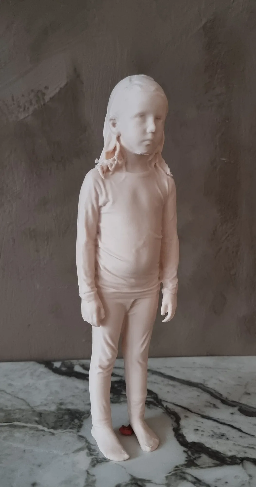

# Her finner du andre typer skulpturer vi lager

Personlige 3D-skulpturer av ekte mennesker, skapt for å bevare øyeblikk, relasjoner og minner som betyr noe.

Hos Sculpt kan du få laget unike skulpturer av deg selv, par, barn og familier, eller forevige en spesiell anledning. Hvert kunstverk formes etter menneskene det skal forestille, og ferdigstilles for hånd med ønsket uttrykk og overflate.

[Klikk her for å se graviditetskulpturer]({{galleryPregnancyPage}})

[Bestill din skulptur]({{contactPage}})

