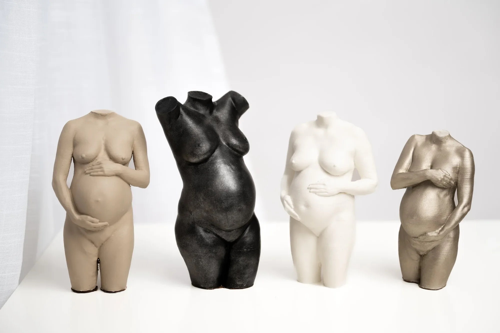
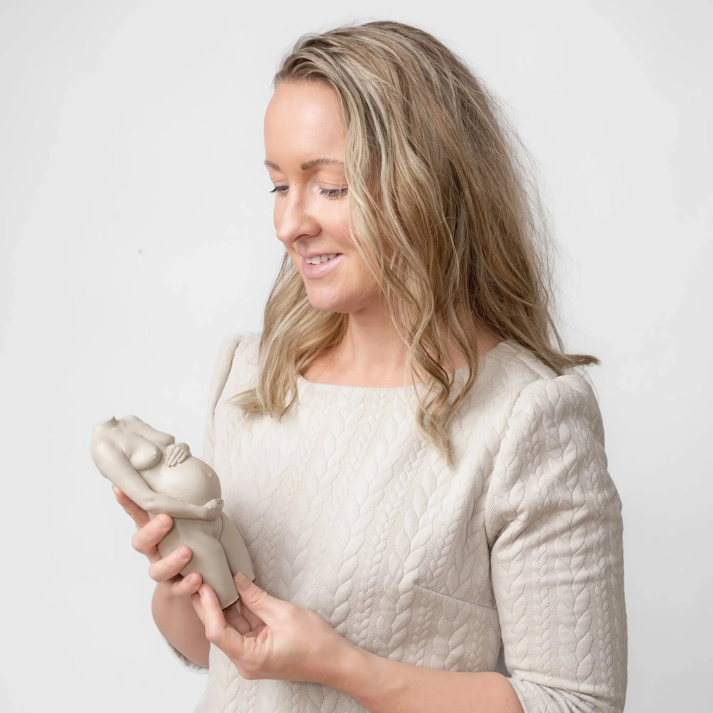
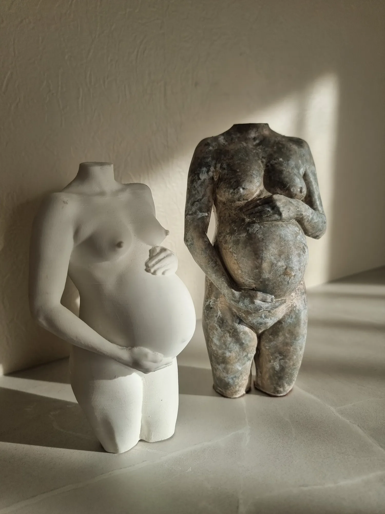
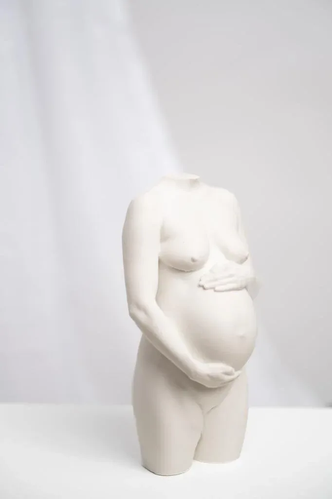
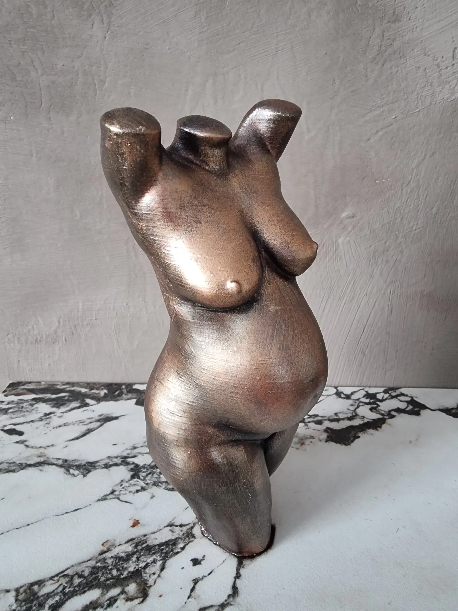
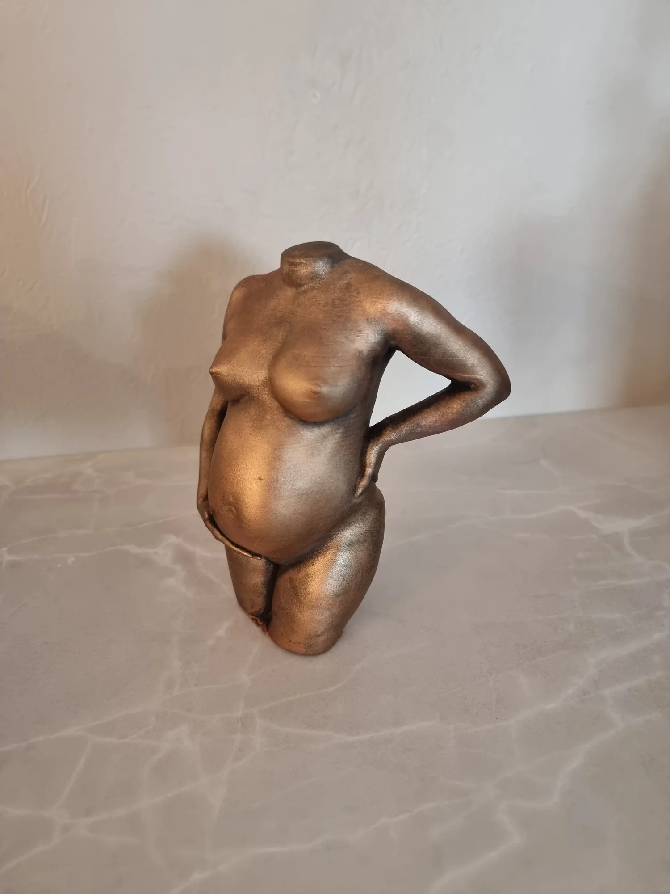
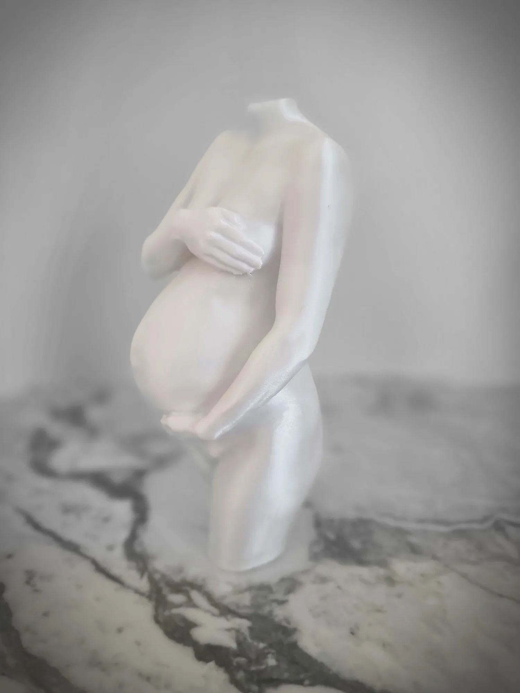
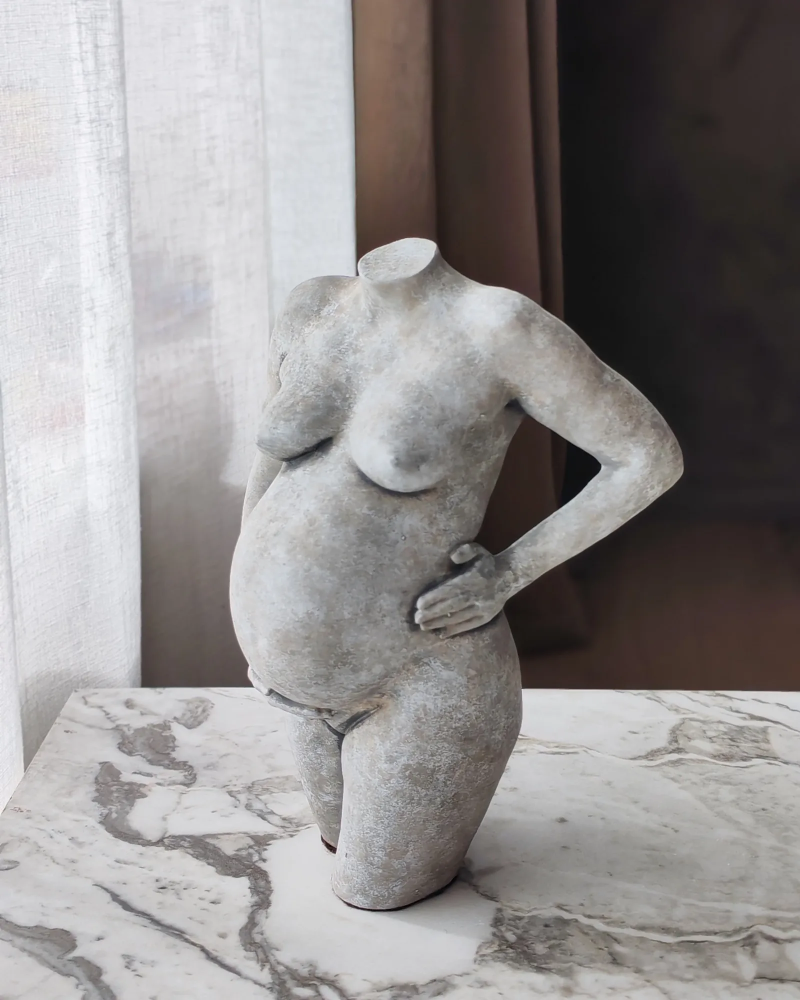
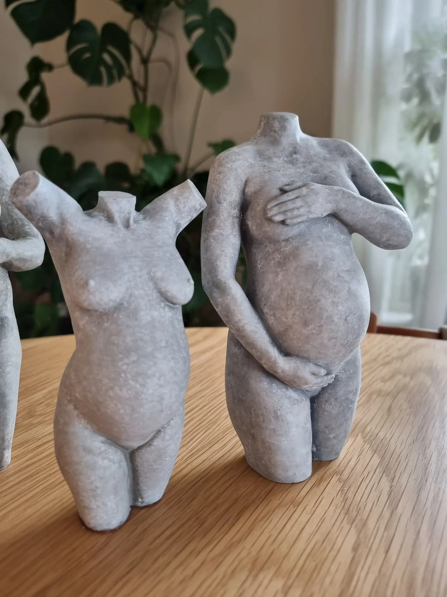
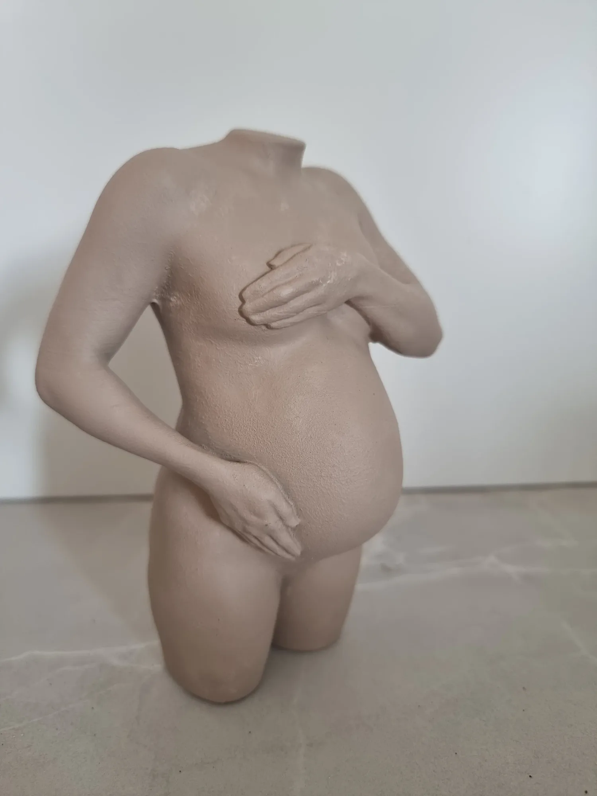

# En skulptur av deg. Mer enn et bilde.

**GRAVIDSKULPTURER OG ANDRE PERSONLIGE SKULPTURER AV EKTE MENNESKER**

Hos Sculpt skaper jeg personlige 3D-skulpturer av ekte mennesker, med gravidskulpturer som spesialitet. Hver skulptur ferdigstilles for hånd til et unikt kunstverk.

**Mer enn et bilde.** Et fysisk minne du kan holde i hendene, kjenne igjen og ta frem igjen i mange år.

Vi tilbyr 3D-skanning i Flekkefjord, Kristiansand, Stavanger, Oslo og Fredrikstad.

[Bestill din skulptur]({{contactPage}})

## Et øyeblikk du alltid vil huske

Tiden går fort, sparkene, magen som vokser, barn som plutselig ikke er små lenger, og eldre som en dag ikke er her. Livets faser endrer seg raskt, og ofte står vi igjen med et ønske om et mer fysisk og håndfast minne fra det som betydde mest.

Med en skulptur bevarer vi menneskers unike former på en annerledes måte. Du kan holde den i hendene, se den fra alle sider og kjenne formene slik de faktisk var.

Men den er også mer enn formen din. Når du ser på eller holder skulpturen, kan den vekke minner om en tid, en relasjon eller en følelse , kjærligheten mellom to mennesker, båndet mellom forelder og barn, eller et viktig kapittel i livet som har formet deg.

Det er noe eget ved å ha minnene fysisk foran seg. De kan føles nærmere og mer levende enn når vi bare ser tilbake på bilder. Noen sier at deres syn på egen kropp endret seg etter en slik opplevelse, at de ikke har sett sin egen kropp som så vakker tidligere.

En gravidskulptur gir deg et nytt perspektiv på deg selv, kroppen din og minnene.

En personlig skulptur erstatter ikke fotografiene dine, men gir deg en annen måte å bevare det som betyr noe for deg.

[Se flere skulpturer]({{galleryPregnancyPage}})

## Hva kundene våre sier

> ⭐️⭐️⭐️⭐️⭐️
>
> Jeg følte meg godt ivaretatt og hele opplevelsen ble utelukkende positiv! Noe som er veldig viktig med tanke på at man står der i all sin nakenhet 😅
>
> Birthe Jøssang

> ⭐️⭐️⭐️⭐️⭐️
>
> Helt fantastisk! Jeg er så takknemlig og glad for at jeg tok sjansen å fikk laget en slik 3d figur av megselv som gravid! Helt nydelig! Blir varm i hjertet hver gang jeg ser på skulpturen min på peishylla!
>
> Jeanette Sørensen

> ⭐️⭐️⭐️⭐️⭐️
>
> Rakk akkuratt å få tatt scanning før lille kom til verden. Veldig fornøyd med scanningen, raskt og smidig. Skulpturen var også nydelig laget. Ordentlig fint minne å ha av magen. Anbefales virkelig!🥰
>
> Elise Bekkevold

Vis flere omtalerVis færre omtaler

> ⭐️⭐️⭐️⭐️⭐️
>
> Jeg får ikke anbefalt dette nok. Gravidkroppen er midlertidig og magisk!!
>
> Ida Kristine Brumoen

> ⭐️⭐️⭐️⭐️⭐️
>
> Kjempefornøyd med skulpturen og hele prosessen!
>
> Tuva Haviken Fjeldsa

> ⭐️⭐️⭐️⭐️⭐️
>
> Utrolig glad jeg oppdaget dette mens jeg gikk gravid, et fint minne om en koselig tid. Kjempefornøyd med skulpturen!
>
> Kristine

[Les flere anmeldelser på Google](https://share.google/piaA8agXoT83MRBzY)

## En enkel og trygg prosess – steg for steg

1. ### Konsultasjon og samtale

2. ### Skanning

3. ### Digital behandling

4. ### Produksjon av skulpturen

5. ### Levering

[Les mer om prosessen]({{processPage}})

[Bestill din skulptur]({{contactPage}})

