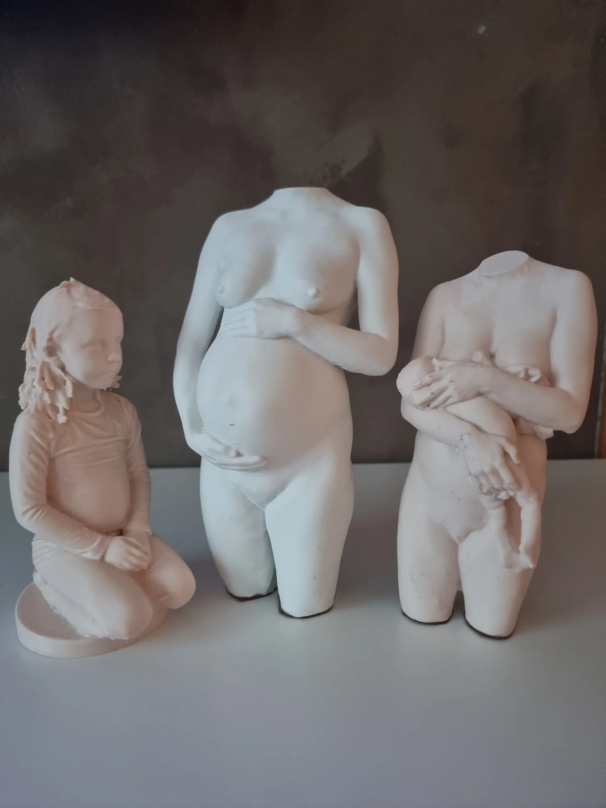

# En enkel og trygg prosess – steg for steg

Å få laget en personlig skulptur er en helt unik opplevelse, og mange lurer på hvordan det faktisk foregår. Derfor har jeg gjort prosessen så trygg, enkel og forutsigbar som mulig. Hos Sculpt blir du fulgt opp gjennom hvert steg – fra første samtale til ferdig skulptur – slik at du alltid vet hva som skjer, og kan føle deg komfortabel hele veien.

Under finner du en oversikt over hele prosessen, og hva du kan forvente fra første møte til skulpturen står klar i hendene dine.

1. ## Konsultasjon og samtale

   Vi starter med en personlig samtale om dine ønsker og hva du ser for deg med skulpturen. Sammen går vi gjennom prosessen og planlegger selve skanningen, samt eventuelle justeringer som kan gjøres digitalt i etterkant.

2. ## Skanning

   Kroppen skannes i en trygg og rolig setting. Skanningen er helt ufarlig for både deg og barnet og tar vanligvis ikke mer enn to minutter. For ekstra presisjon kan vi bruke et elektrisk snurrebord og stativ (valgfritt). Kun kunstneren har tilgang til skanningen. Du skannes naken eller med sømløs truse for best mulig detaljbevaring.

3. ## Digital behandling

   Etter skanningen bearbeides modellen digitalt for å sikre høy presisjon og kvalitet. Justeringene gjøres mens du er til stede, slik at du selv kan være med og bestemme hvordan resultatet skal bli. Vi kan også myke opp eller fjerne små detaljer dersom du ønsker det.

4. ## 3D-modellering

   Basert på skanningen lages en nøyaktig 3D-modell av kroppen din. Her finjusteres form og detaljer slik at skulpturen gjengir uttrykket på en naturlig og vakker måte.

5. ## Produksjon av skulpturen

   Skulpturen 3D-printes i PLA – et biobasert og miljøvennlig materiale. Deretter bearbeides den for hånd før overflate og finish tilpasses nøye etter dine ønsker.

6. ## Levering

   Når skulpturen er ferdig, pakkes den trygt og sendes til deg. Hver skulptur behandles med stor omtanke, slik at du mottar et varig minne med høy kvalitet og personlig preg.

## Om skulpturen

Skulpturene lages gjennom en kombinasjon av en rask **3D-skanning av kroppen, digital bearbeiding, 3D-printing og håndarbeid i etterbehandlingen**.

Hver skulptur starter med en personlig skanning av kroppen med en håndholdt 3D-skanner. Skanningen kan sammenlignes med at det tas tusenvis av “bilder” av kroppen din fra alle vinkler, som i løpet av kort tid settes sammen til en nøyaktig 3D-modell. Prosessen er helt ufarlig og ikke-invasiv, og du utsettes ikke for stråling eller andre belastninger. Denne modellen bearbeides deretter digitalt for å sikre form, uttrykk og balanse før den printes i 3D og videre ferdigstilles for hånd. Det er i håndarbeidet skulpturen virkelig får sitt unike uttrykk utover de personlige kroppslige detaljene i printen. Her kombineres kundens ønsker med en forståelse og kjennskap til personen gjennom skanneavtalen, slik at kunstneren kan bruke dette i den videre kunstneriske utformingen av skulpturen.

Skulpturene fra Sculpt lages med en biobasert polymer som grunnmateriale. Materialet er nøye valgt for sine egenskaper og mulighetene det gir for kunstnerisk bearbeiding.

Den høye detaljgraden gjør det mulig å gjenskape og fremheve personlige trekk, former og små detaljer med stor presisjon. Samtidig gir materialet kunstneren frihet til å bearbeide overflaten og skape et vakkert, helhetlig uttrykk, tilpasset hver enkelt skulptur.

Gjennom digital bearbeiding, håndarbeid og individuelt tilpasset finish forvandles grunnmaterialet til et personlig kunstverk med sitt eget særpreg.

Materialet er også valgt med tanke på styrke, holdbarhet og et mer bevisst materialvalg i produksjonen.

Ettersom skulpturene fremstilles ved hjelp av 3D-printing, bygges de opp lag for lag, som ikke smeltes sammen. Dette kan medføre svake linjer i overflaten som i enkelte tilfeller kan være synlige ved nærmere ettersyn, også på det ferdige kunstverket.

Hos Sculpt arbeider vi grundig med å redusere og kamuflere disse gjennom manuell bearbeiding og ulike teknikker for overflatebehandling. Samtidig krever dette en nøye balansegang mellom å oppnå en vakker, jevn overflate og å bevare de små, personlige detaljene fra kroppsskanningen.

For mye sliping kan føre til at nettopp disse detaljene går tapt. Å finne denne balansen er en kunst i seg selv, og noe Sculpt har spesialisert seg på.

Hver skulptur bearbeides derfor individuelt, med stor omtanke for både detaljene og det ferdige kunstneriske uttrykket.

Hver skulptur er opptil **25 cm høy**, og produseres som et solid og vektet objekt for å gi en stabil og kunstnerisk tilstedeværelse til utstilling der du ønsker i hjemmet. Det kan lages større skulpturer, men da må skulpturen deles opp og settes sammen.

**Skulpturen er et personlig minne du har lyst til å ha fremme. Underveis snakker vi om positur, farge og utførelse, og finner sammen uttrykket som passer  deg og hjemmet ditt.**

Skulpturene kan lages i ulike **positurer, uttrykk og overflateutførelser**, avhengig av kundens valg og ønsket estetikk.

Alle skulpturer er **custom made og unike**.

For å ivareta autentisiteten i uttrykket gjøres det ikke justeringer av kroppens grunnleggende proporsjoner. Kroppen gjengis slik den fremkommer i skanningen, uten idealisering eller endring av former. Vi kan likevel gjøre mye med overflater og enten fremheve detaljer eller duse ut detaljer e.l.

Skulpturen er solid, men den kan skades ved fall eller om den utsettes for sterk sol over tid.

Fordi skulpturen skapes gjennom en rekke ulike prosesser tar den tid å lage, og det tar vanligvis rundt ca 1 måned før den er ferdig og sendes.

[Bestill din skulptur]({{contactPage}})

